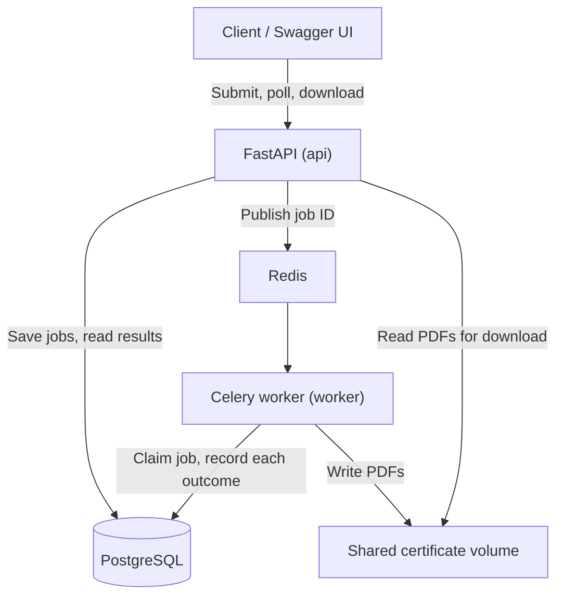

# Bulk Certificate Generator

A FastAPI service that accepts one batch of recipients, validates each entry
independently, and generates one PDF certificate per valid recipient in a
background Celery worker. Clients poll progress, page through per-recipient
results, and download each certificate.

What it is built to show:

- **Valid certificates are generated correctly**: a fixed ReportLab template,
  bundled fonts, long text that wraps and shrinks instead of being clipped,
  and an explicit list of supported characters.
- **Individual failures are isolated**: one recipient that cannot be rendered
  or saved is recorded as `FAILED` and the rest of the batch continues.
- **Job progress is accurate**: PostgreSQL is the source of truth; counts are
  computed from recipient rows in one consistent read.

Detailed design decisions, measurements, and trade-offs: [docs/design.md](docs/design.md).

## Architecture



| Component | Choice |
|---|---|
| API | Python 3.12, FastAPI, Pydantic |
| Database | PostgreSQL 17, SQLAlchemy 2 (sync), Alembic migrations |
| Background work | Celery 5.6 with Redis 7 (one task per job) |
| PDF | ReportLab with bundled DejaVu fonts |
| Tests | pytest, HTTPX, pypdf |
| Local setup | Docker Compose |

## Quick start

Requires Docker with Compose v2. Port 8000 must be free (or set `API_PORT`).

```bash
git clone <repository-url> bulk-certificate-generator
```

```bash
cd bulk-certificate-generator
```

```bash
docker compose up --build -d --wait
```

This builds one image and starts PostgreSQL, Redis, a one-off `migrate`
container that runs `alembic upgrade head`, the API, and the Celery worker.
API and worker start only after the migrations succeed. No `.env` file is
needed; `.env.example` lists the optional overrides.

- Health check: http://localhost:8000/health
- Swagger UI: http://localhost:8000/docs (submit, check status, list results, download)

Migrations can also be run by hand:

```bash
docker compose run --rm migrate
```

Stop everything (data is kept in named volumes):

```bash
docker compose down
```

## Try it

### Whole flow in one command

```bash
sh examples/curl-demo.sh examples/job-request.json
```

It submits the batch, polls until it finishes, prints the results, and saves
the first certificate as `certificate.pdf`. It needs only `curl` and a POSIX
shell (Git Bash works on Windows).

### Step by step

Submit a batch (two valid recipients, one invalid):

```bash
curl -X POST http://localhost:8000/api/v1/jobs -H "Content-Type: application/json" --data @examples/job-request.json
```

```json
{"job_id": "7e524b50-...", "status": "QUEUED", "total_count": 3, "valid_count": 2, "invalid_count": 1, "status_url": "/api/v1/jobs/7e524b50-..."}
```

Poll progress until `status` is `COMPLETED`, `COMPLETED_WITH_ERRORS`, or `FAILED`:

```bash
curl http://localhost:8000/api/v1/jobs/JOB_ID
```

```json
{"job_id": "...", "status": "COMPLETED_WITH_ERRORS", "total_count": 3, "pending_count": 0, "processing_count": 0,
 "success_count": 2, "invalid_count": 1, "failed_count": 0, "processed_count": 3, "progress_percent": 100.0, "...": "..."}
```

List per-recipient results (paginated; `limit` 1–200, default 50):

```bash
curl "http://localhost:8000/api/v1/jobs/JOB_ID/recipients?limit=50&offset=0"
```

Each item has `recipient_id`, `input_index`, `status`, `name`, `email`, `achievement`,
`errors` (for `INVALID` / `FAILED`), and `download_url` (for `SUCCESS`).

Download one certificate (the `recipient_id` is the certificate ID):

```bash
curl -o certificate.pdf http://localhost:8000/api/v1/certificates/CERTIFICATE_ID/download
```

Other sample requests in [examples/](examples/):

| File | Result |
|---|---|
| `job-request.json` | `202`; 2 certificates, 1 `INVALID` entry |
| `job-request-all-valid.json` | `202`; 4 certificates, including accented and Cyrillic names |
| `job-request-with-achievement.json` | `202`; 2 certificates, one with the optional `achievement` line |
| `job-request-all-invalid.json` | `422 all_recipients_invalid` with indexed errors; no job created |
| `job-request-invalid-shared.json` | `422` (empty event name, non-ISO date); no job created |

A sample certificate of each kind is in
[examples/sample-certificates/](examples/sample-certificates/).

## API

| Method | Endpoint | Responses |
|---|---|---|
| `POST` | `/api/v1/jobs` | `202` accepted; `422` invalid request; `503 dispatch_failed` |
| `GET` | `/api/v1/jobs/{job_id}` | `200` status and counts; `404 job_not_found` |
| `GET` | `/api/v1/jobs/{job_id}/recipients` | `200` page of results; `404`; `422` bad `limit`/`offset` |
| `GET` | `/api/v1/certificates/{certificate_id}/download` | `200` PDF; `404 certificate_not_found`; `409 certificate_not_ready` (pending/processing) or `certificate_not_available` (invalid/failed); `500 certificate_file_missing` |
| `GET` | `/health` | `200`; `503` if PostgreSQL is unreachable |

Full response shapes and error codes: [docs/design.md](docs/design.md#api-contract)
and Swagger UI.

## Behaviour

### Validation

| Input | Rule |
|---|---|
| `event_name`, `issuer_name` | required; trimmed and NFC-normalized; 1–200 characters; supported characters only |
| `issue_date` | required `YYYY-MM-DD` that is a real date |
| `recipients` | required list of 1–1,000 entries (application limit, `MAX_RECIPIENTS_PER_JOB`) |
| recipient `name` | required; trimmed and NFC-normalized; 1–150 characters; supported characters only |
| recipient `email` | optional or `null`; syntax checked when given (no DNS lookup) |
| recipient `achievement` | optional; omitted, `null`, or blank means none; otherwise trimmed and NFC-normalized, up to 150 characters, supported characters only; printed below the event name as "and is recognized for …" |
| duplicates | allowed; each entry gets its own certificate |

Invalid shared fields reject the request (`422`, nothing saved). Each
recipient is validated on its own: invalid entries are stored as `INVALID`
with `{field, code, message}` errors and their original `input_index`, and
the rest of the batch is accepted. If every recipient is invalid, the
response is `422` with indexed errors and nothing is saved. Unknown extra
fields are ignored.

**Supported characters** (an application limitation): Latin (including
accented and Vietnamese letters), Greek, Cyrillic, and common punctuation.
Scripts that need shaping or right-to-left layout (Devanagari, Arabic,
Hebrew, Thai), CJK, emoji, and control characters are rejected at submission
with `unsupported_characters`, because ReportLab and the bundled fonts cannot
display them correctly.

### Statuses and progress

| Recipient | Meaning | | Job | Meaning |
|---|---|---|---|---|
| `PENDING` | valid, waiting | | `QUEUED` | waiting for a worker |
| `PROCESSING` | being generated | | `PROCESSING` | claimed by a worker |
| `SUCCESS` | PDF saved | | `COMPLETED` | every recipient succeeded |
| `INVALID` | failed validation | | `COMPLETED_WITH_ERRORS` | finished; some successes, some `INVALID`/`FAILED` |
| `FAILED` | could not be generated or queued | | `FAILED` | finished with zero successes, or could not be queued |

```text
processed_count  = success_count + invalid_count + failed_count
progress_percent = processed_count / total_count * 100
```

100% means every entry has a final outcome, not that every certificate
succeeded.

### Processing and transaction boundaries

- `POST` saves the job and every recipient row in **one transaction**, then
  publishes a Celery task whose only argument is the job ID. The API never
  renders PDFs.
- The worker **claims** the job with one conditional
  `UPDATE ... WHERE status = 'QUEUED'`; only one caller can win, so a
  redelivered or duplicate message does nothing.
- Each recipient is processed in `input_index` order with short transactions:
  mark `PROCESSING`, then render and save the PDF **with no transaction
  open**, then record `SUCCESS` (with the file's key) or `FAILED` (with an
  error code such as `text_does_not_fit` or `storage_error`). One failure does
  not stop the rest.
- The job's final status is derived from the recipient rows.
- A database error stops processing and is raised, never recorded as a
  certificate failure; results already committed are kept.

### Storage

PDFs are stored in a volume shared by the API and worker, named
`{certificate_id}.pdf` from the generated recipient ID (never from user
input). Files are written to a temporary file in the same directory and
atomically renamed. `SUCCESS` is committed only after the file exists, and
downloads are decided by the database row, never by the file's existence.

### Failures

- **Redis unavailable at submission:** `503 dispatch_failed`; the job and its
  pending recipients are recorded as `FAILED`, so nothing reports success.
  This never overwrites a job a worker already claimed.
- **Graceful worker stop** (`docker compose stop`): running jobs may finish for
  up to 2 minutes.
- **Worker crash mid-job:** the job stays `PROCESSING`; automatic recovery is
  not implemented (see limitations). Certificates already produced stay valid.

## Tests

```bash
docker compose run --rm --build tests
```

225 tests, all passing at the time of writing (one known
`StarletteDeprecationWarning` about `httpx`, deliberately not suppressed).
They use a dedicated database, `certificates_test`, which is dropped,
recreated, and migrated with Alembic on every run; the run refuses to start if
the test database could be the application database. Most tests publish to
Celery's in-memory broker. The integration tests start a real API process and
a real Celery worker connected through Redis database 1 and go through
submit, poll, results, and download over HTTP.

Run the quick part only (no real worker):

```bash
docker compose run --rm --build tests pytest -m "not integration"
```

A table mapping each required scenario to its tests is in
[docs/design.md](docs/design.md#checklist-coverage).

## Measured performance

One run on the development machine (Docker Desktop on Windows, worker
concurrency 2). These are single measurements, not throughput guarantees.

| Batch | `202` after | Worker processing | Per certificate | Outcome |
|---|---|---|---|---|
| 100 recipients | 0.25 s | 3.63 s | 36 ms | 100 `SUCCESS` |
| 1,000 recipients | – | 29.9 s | 30 ms | 1,000 `SUCCESS` |

Reproduce:

```bash
python scripts/benchmark.py --recipients 100
```

## Configuration

| Variable | Default | Used by |
|---|---|---|
| `API_PORT` | `8000` | host port for the API |
| `WORKER_CONCURRENCY` | `2` | jobs processed in parallel |
| `LOG_LEVEL` | `INFO` | API and worker |
| `POSTGRES_USER`, `POSTGRES_PASSWORD`, `POSTGRES_DB` | `certificates` | database container and connection URL |

Inside the containers Compose sets `DATABASE_URL`, `CELERY_BROKER_URL`, and
`CERTIFICATE_STORAGE_DIR`. The default credentials are for local use only.

## Operations

```bash
docker compose logs -f worker
```

Run one queued job by hand, without Celery (exit code 0 done, 1 unknown job,
2 stopped by a database error):

```bash
docker compose exec worker python -m app.cli process-job JOB_ID
```

Copy a certificate out of the volume:

```bash
docker compose cp worker:/data/certificates/CERTIFICATE_ID.pdf ./certificate.pdf
```

## Limitations and future work

- **No recovery of interrupted jobs:** a job whose worker crashed stays
  `PROCESSING`. It needs a reclaim rule (e.g. no progress for N minutes) before
  automatic retries can be added safely.
- **Commit-to-publish window:** if the API dies between saving a job and
  publishing it, the job stays `QUEUED`. A transactional outbox or a sweeper
  would close this.
- **No idempotency key:** submitting the same request twice creates two jobs.
- **No cleanup** of PDFs left without a `SUCCESS` row after a database error,
  or of temporary files from a killed write.
- **Slow `503` with a stopped Redis container:** the publish waits on DNS
  lookups, 8–16 s measured.
- **No authentication;** certificate IDs are random UUIDs.
- **Limited scripts** in names and event text (see Validation).
- Recipients are processed sequentially within a job. For far larger batches
  (100,000 recipients): chunked ingestion and processing, bounded parallelism
  within a job, object storage instead of a shared volume, and the recovery
  rule above.

## Project layout

| Path | Responsibility |
|---|---|
| `app/main.py` | FastAPI application |
| `app/api/` | thin HTTP routes (`jobs.py`, `certificates.py`, `health.py`) and response URLs |
| `app/schemas.py` | request validation and response models |
| `app/text_policy.py`, `app/fonts.py` | shared character rules and bundled fonts |
| `app/models.py`, `migrations/` | database models and Alembic migrations |
| `app/services/jobs.py` | job creation and dispatch-failure handling |
| `app/services/validation.py` | per-recipient validation |
| `app/services/generation.py` | `process_job`: claim, per-recipient processing, finalization |
| `app/services/pdf.py`, `storage.py` | certificate rendering and atomic file storage |
| `app/services/progress.py`, `results.py` | status counts, recipient pages, downloads |
| `app/worker.py`, `app/services/dispatch.py` | Celery app, task, and publishing |
| `app/cli.py` | `process-job` command |
| `tests/` | automated tests |
| `examples/`, `scripts/` | sample requests, curl demo, benchmark, sample certificates |

## Dependencies

`requirements.in` and `requirements-dev.in` list direct dependencies;
`requirements.txt` and `requirements-dev.txt` are generated lock files. To
re-lock after changing an `.in` file:

```bash
docker run --rm -v "$PWD":/src -w /src python:3.12-slim sh -c "pip install -q uv && uv pip compile requirements.in --universal --python-version 3.12 -o requirements.txt && uv pip compile requirements-dev.in --universal --python-version 3.12 -o requirements-dev.txt"
```
